  

  <i>Named after Antares — the red heart of Scorpius, a star wide enough to swallow the orbit of Mars.</i>

  

### ✦ Currently observing

- **Agentic engineering** — Claude Code, skills, MCP servers, autonomous dev pipelines
- **Local LLM inference** — big models on consumer hardware
- **Reverse engineering** — Ghidra and agent-driven binary analysis
- **AI-native game dev** — Godot, Bevy and procedural everything

  

  

  

